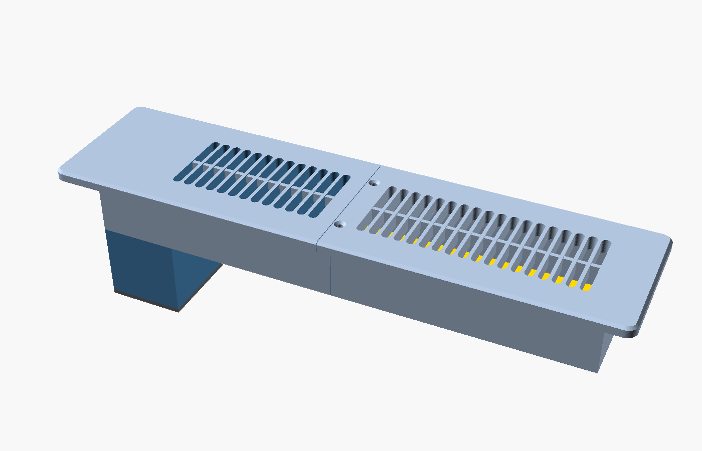
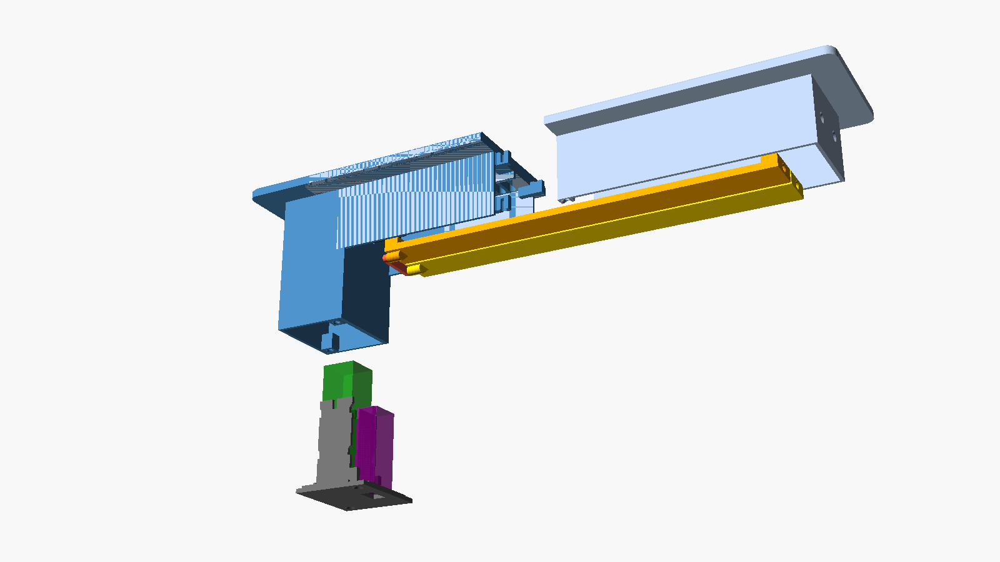

# Battery + Thread Smart Vent (2x12, XIAO ESP32-C6)

> **Status: untested hardware.** The firmware compiles and the model passes
> a collision check across the louvers' swing, but nothing has been built or
> measured yet. Run the [first-article checks](#first-article-checks) on the
> first unit before building the rest. The findings of the pre-production
> review are in [DESIGN_REVIEW.md](DESIGN_REVIEW.md).

## Why this variant

The original vent uses an ESP8266 on Wi-Fi with wired power. On a battery,
Wi-Fi either drains the cell in days or has to deep-sleep, and then it takes
minutes to respond to a command. This variant uses:

- **Thread, as a sleepy end device.** The radio sleeps and checks in with its
  parent router every `thread_poll_period` (default 5 s). The border router
  holds commands until then, so a vent responds within a few seconds.
- **ESP-IDF automatic light sleep** between check-ins. ESPHome does not do
  this by itself yet. The small `components/smart_vent_power` external
  component turns it on and keeps the CPU awake only while the servo moves.
- **A fully power-gated servo.** The backpack board's load switch cuts the
  servo's 5 V boost converter off from the cell between moves. The limit
  switch and the feedback potentiometer are powered only during a move too,
  so they draw nothing at rest.

Why the C6 and not the H2: the H2 should draw a little less power, but the
C6 is on a cheap, tiny board (the XIAO) with a Li-ion charger built in, and
it keeps Wi-Fi as a fallback if Thread disappoints. The firmware would move
to an H2 board with only pin and board changes.

## Parts list

For distributor part numbers and prices, see [BOM.md](BOM.md).

| Qty | Part | Notes |
|---|---|---|
| 1 | Seeed Studio XIAO ESP32-C6 | Battery pads and USB-C charging on board |
| 1 | Feetech FT90M-FB servo | Micro, metal gear, 280°, **rated −15 to 70 °C** (supply air reaches ~54 °C), analog position feedback on a 4th wire (up to 4.45 V per Feetech's sheet). Check the wire colours on arrival |
| 1 | Backpack board ([`hardware/xiao-backpack`](../hardware/xiao-backpack)) | Reverse-polarity protection, load switch, 5 V boost, both dividers and the connectors. JLCPCB assembles the SMD parts |
| 1 | Panasonic ESE-11HS2 detector switch | Closed limit switch, same as upstream |
| 1 | 18650 Li-ion cell, **protected**, 3000–3500 mAh | A protected cell has a built-in protection circuit |
| 1 | Single-18650 holder with wire leads | Stands upright in the tower |
| 9 | M3 heat-set insert, 4.6 mm OD × 5.7 mm long (4.0 mm hole, 7 mm deep in the model) | 4 centre joint, 2 lid, 3 louver axles |
| 2 | M3 × 10 flat-head screw | Centre joint, top (through the grille) |
| 6 | M3 × 8 flat-head screw | Centre joint bottom (2), far-end louver axles (2), lid (2) |
| 1 | M3 × 16 flat-head screw | Follower louver axle through the partition (crosses a 6.6 mm gap) |
| – | Closed-cell foam, about 3 mm | Lines the tower (see [Heat](#heat-gas-furnace)) |

If your inserts need a different hole size, change `insert_d` and
`insert_depth` at the top of the `.scad` file.

## Wiring

Everything plugs into the backpack board; its
[README](../hardware/xiao-backpack/README.md) has the circuit.

| Connector | Goes to |
|---|---|
| J1 (JST-PH, pin 1 = **+**) | Cell holder leads |
| J2: GND, +5V, SIG, FB | Servo: ground, power, signal, feedback wire |
| J3 | Limit switch (either way round) |
| TP1 (+), TP2 (−) | Short wires to the XIAO's `BAT+` / `BAT−` pads |

The board uses XIAO pins D0 (battery sense), D1 (servo feedback), D2 (servo
signal), D3 (servo power + limit switch feed) and D4 (limit switch).

## Firmware

- `yet-another-smart-vent-xiao-esp32c6-thread.yaml` is the device file to
  copy into your ESPHome dashboard. It pulls the package and the external
  component from GitHub. Set `repo_ref` to the branch or tag you want.
- `common/smart-vent-thread-battery-base.yaml` holds the logic.
- Add your Thread dataset to `secrets.yaml` as `thread_tlv`. In Home
  Assistant, go to **Settings → Devices & services → Thread**, click the
  **(i)** next to your network, and copy the active dataset TLVs.

The first flash has to be over USB. Thread only works once the device has
the dataset.

### Home Assistant entities

| Entity | Purpose |
|---|---|
| `cover.*_vent` | Damper with position (0 = closed, 100 = open) |
| `sensor.*_battery`, `sensor.*_battery_voltage` | Charge level (rough Li-ion curve) and raw voltage |
| `sensor.*_bay_temperature` | Chip temperature inside the tower, used to watch furnace heat |
| `switch.*_maintenance_mode` | Radio always on for 15 minutes. **Turn it on before an OTA update.** |
| `button.*_recalibrate` | Re-runs the sweep to the limit switch |
| `binary_sensor.*_blocked` | The last move ended away from its target: something is in the louvers, the linkage came apart or the servo failed |
| `binary_sensor.*_battery_lockout` | The cell is nearly flat; the vent has opened and ignores close commands |
| `binary_sensor.*_overheated` | The bay passed `overtemp_open_c`; the vent has opened and holds until it cools |

### Behaviour

- **First boot:** the vent sweeps toward closed until the limit switch trips,
  then opens 90°. The calibration is saved to flash, so later reboots
  (battery swaps) don't sweep again. They read the feedback potentiometer
  to find where the louvers are.
- **Every move:** power the servo rail, move over `servo_transition_length`,
  read the feedback to report the real position, then cut the power.
- **Fail-safes.** Each one runs on the vent itself and **opens** it,
  because a closed vent nobody can command starves the furnace of air:
  - Home Assistant unreachable for `failsafe_open_after_minutes`
    (default 30).
  - Cell below `low_battery_volts` (default 3.45 V, about 5% left) on two
    readings: the vent opens and stays open until recharged, so it can
    never run flat while shut.
  - Chip temperature above `overtemp_open_c` (default 66 °C): the vent
    opens and holds until it drops below `overtemp_clear_c`.

## Power budget (estimates, to be measured)

| State | Assumed current | Share of time | Average |
|---|---|---|---|
| Light sleep, radio off | ~0.1–0.3 mA (C6 datasheet-class figure; board leakage adds some) | ~99.9% | 0.1–0.3 mA |
| Thread poll every 5 s | ~20–30 mA for ~5 ms | 0.1% | ~0.03 mA |
| Battery sense divider | 2 µA | 100% | 0.002 mA |
| Servo move, 3.4 s at ~250 mA from the cell | ~0.25 mAh per move | 10 moves/day | ~0.1 mA |
| **Total** | | | **≈ 0.25–0.45 mA** |

On a 3000 mAh cell that is roughly **9–14 months** per charge, if light
sleep really engages. If it does not, the board idles at about 15–25 mA
and the cell lasts about a week. The `smart_vent_power` component exists to
prevent that, and test step 3 checks it.

## Heat (gas furnace)

Supply air from a gas furnace is return air plus the furnace's rated rise.
For an Ameristar M801P080BU36 (30–60 °F rise) that's about **37–53 °C
(98–128 °F)** leaving the furnace, and a bit less at the register. It runs
hotter if closed vents push the rise past its rating; see
[Delta Tango](../delta-tango/README.md).

- **Print everything in ASA (best) or PETG.** PLA softens around 55–60 °C
  and long thin parts will sag or warp.
- The cell sits in a closed tower that air flows around, not through. Line
  the tower's end wall and sides with ~3 mm closed-cell foam (the tower has
  `liner_t` of room for it) to slow how fast it heats up.
- A protected 18650 cell can deliver power up to about 60 °C. Long periods
  above about 45 °C wear it out faster, which shows up as lost capacity.
  Watch `Bay Temperature` over the first heating season. If it routinely
  sits above about 45 °C, consider lithium AA primary cells (rated to 60 °C;
  needs a different holder and a regulator change) or moving the cell
  outside the duct.
- **Recharging:** swap in a charged cell and recharge the flat one in an
  18650 charger. The XIAO's own charger delivers only about 100 mA (35–40
  hours for a 3400 mAh cell) and has no temperature sensor, so use USB-C
  only for top-ups and firmware, and **never while the heat is running**.
- The board blocks a cell fitted backwards. **Don't plug in USB while a
  cell is reversed**: the XIAO's charger would then drive current into it.

## 3D printing

Source: [`cad/smart_vent_2x12_battery.scad`](../cad/smart_vent_2x12_battery.scad) (OpenSCAD).
Pre-exported STLs are in `cad/stl/`, already in print orientation.

| Part | Qty | Orientation / notes |
|---|---|---|
| `body_left` | 1 | Grille face down. Includes the electronics tower. Supports needed only for the partition's servo opening |
| `body_right` | 1 | Grille face down |
| `louver_driven` | 1 | Flat side down. About 244 mm long, so print it diagonally on a bed smaller than 250 mm |
| `louver_follower` | 1 | Same as above |
| `link` | 1 | Flat |
| `lid` | 1 | Flat, cradle posts up |

Suggested settings: ASA/PETG, 0.2 mm layers, 4 walls, 25% gyroid infill,
100% infill on the louvers.

Each body half fits a 180 × 180 mm bed. The grille is split at the centre
and joined with four M3 screws into heat-set inserts. Two go in from the
top (countersunk) and two from below.

## Assembly order

1. Fit the heat-set inserts: 4 in the left half's centre bosses (2 top
   faces, 2 bottom faces), 2 in the tower's lid bosses, 1 in the far end of
   each louver, and 1 in the servo end of the follower louver.
2. Join the two body halves: 2 screws from the top through the right grille
   and 2 from below through the right-hand tabs.
3. Trim a single-arm servo horn to about 10 mm and screw it into the pocket
   on the driven louver's servo end, using the servo's own small screws.
4. Push both crank pins into the link (the cranks hang down, below the
   louvers), then drop both louvers in from below. Fix the follower with an
   M3 × 16 flat-head through the partition from the bay side, and fix both
   far ends with M3 × 8 flat-heads through the end wall. **These screws are
   the louvers' axles: snug them, then back off a quarter turn** so the
   louvers swing freely, and lock each with a dab of nail polish on the
   head.
5. Power the servo once so it sits at its centre (flash the board and let
   calibration fail, or use a servo tester). Hold the louvers **half open
   (45°)**, slide the servo in from the bay so its spline engages the horn,
   then screw its tabs to the partition. Calibration needs the closed
   position within about 120° of the servo's centre, and this puts it 45°
   away.
6. Glue the limit switch under the pad on the side wall, lever down, above
   the driven louver's outer edge at the servo end. Close the louvers by
   hand and set the switch so it clicks just as they reach closed. Run its
   wires through the hole in the partition beside the pad.
7. Plug the servo, switch and cell holder into the backpack. It slots into
   the lid cradle with USB-C pointing down through the lid. Put the cell
   holder at the end wall (zip-tie slots provided) and add the foam liner.
8. Screw on the lid.

## Measurements needed before the first full print

The defaults come from photos and the upstream 2x12 model, which uses a
body about 54 mm wide and 36 mm deep. **Measure your boot**, then adjust
these values at the top of the `.scad` file:

- `body_len` / `body_w`: the inside of the boot, minus about 2 mm each way
  for clearance.
- `bay_depth` (default 85 mm): the tower holds an upright 18650. With the
  lid it reaches 87.5 mm below the floor, which leaves about 14 mm in a 4"
  (101.6 mm, `boot_depth`) boot. The model refuses to render if the tower
  stops fitting. If the duct leaves the boot right under the tower's end,
  that 14 mm gap restricts airflow, so put the tower at the other end (mirror
  the model).
- `flange_len` / `flange_w`: the size of your current register cover.

Print the `fit_test` part first: a short slice of the tower end with an
insert boss and the servo opening.

## First-article checks

Do these on the **first** unit, before assembling the rest.

1. **Board only, on USB:** flash it, confirm it joins Thread and shows up
   in Home Assistant, and that Maintenance Mode plus an OTA update works.
2. **Servo rail:** with a cell fitted and the board idle, J2's +5V pin must
   read about 0 V. During a move it should read about 5.1 V. Fit the cell
   backwards once: nothing should power up or get warm.
3. **Sleep current (the important one):** power the XIAO from a bench
   supply or the cell through a µA-capable meter (for example a Nordic PPK2,
   or a multimeter on its µA range with a shunt switch to bypass it while
   the board boots). Measure the average over 60 s while idle. **Target
   below 0.5 mA.** If it's much higher, try `light_sleep: false` vs `true`,
   longer `idle_loop_interval`, and a longer poll period, and capture logs.
4. **Servo feedback:** with the servo powered from 5 V, measure the
   feedback wire at both ends of travel. It must stay under 4.9 V.
5. **Mechanics:** confirm calibration, the 90° swing, the limit switch
   trigger, and repeatability over about 50 moves. Block a louver by hand
   during a move: `Blocked` should turn on.
6. **Radio, in the floor:** with the vent seated in its metal boot, check
   that it stays connected and responds within a few seconds. If it drops
   out, fit a U.FL antenna and set `external_antenna: 'true'`, or add a
   mains-powered Thread router nearby.
7. **Through one heating season:** log battery voltage and bay
   temperature.
