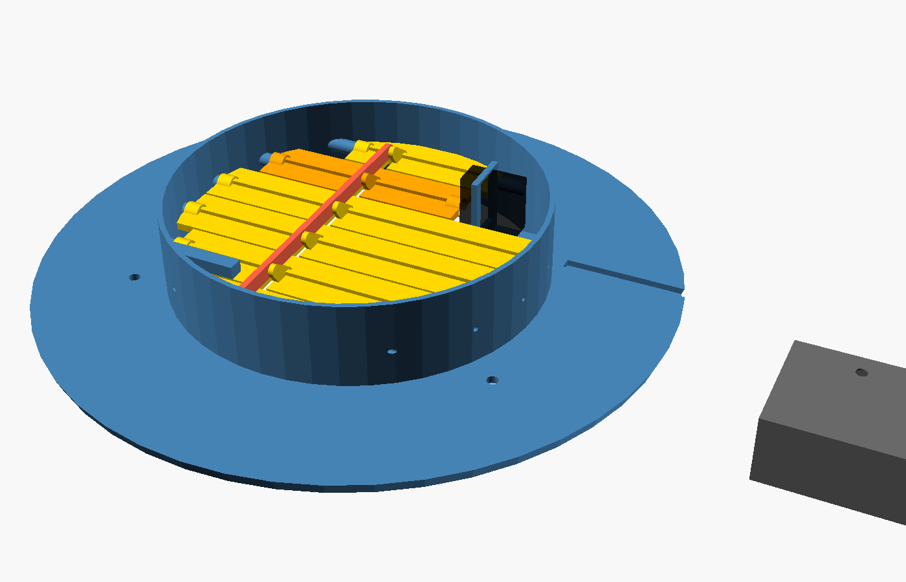
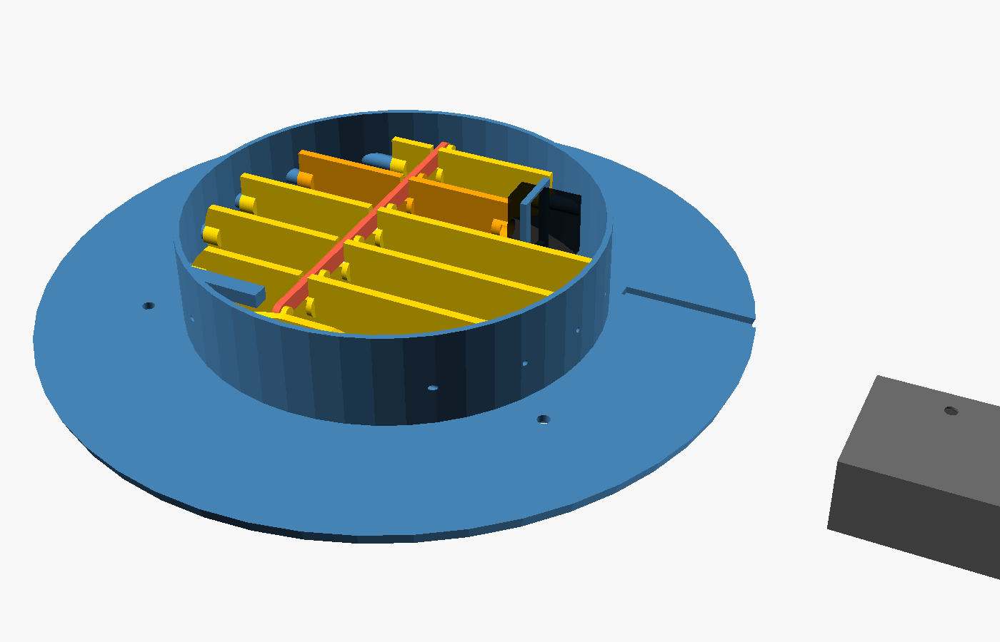
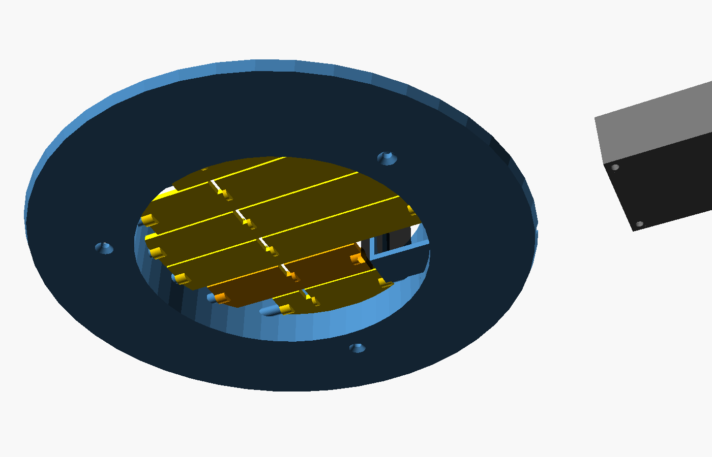

# 6" round ceiling vent (louvered, battery pod beside it)

A replacement for a 6" round ceiling diffuser such as the AmeriFlow 1500W6
(9‑15/16" face, 6" duct). It uses the same electronics as the 2x12 floor
vent: XIAO ESP32-C6 + backpack board, Feetech FT90M-FB feedback servo, limit switch.
The battery and electronics live in a small **pod on the ceiling beside
the vent**, out of the warm supply air.

| Closed | Open | From the room |
|---|---|---|
|  |  |  |

> **Status: first draft, not printed yet.** The model has been checked for
> collisions: every pair of parts, at 0°, 15°, 30°, 45°, 60°, 75° and 90°.
> The real vent's dimensions still need confirming (below).

## How it works

- Six louvers span the 6" opening. Each is shaped to the circle and pivots
  on 1.75 mm filament pins through the neck wall.
- A link bar joins their cranks. The cranks swing from −45° to +45° around
  vertical (louvers closed to open), so the linkage never reaches its dead
  point. A thin slot in each louver clears the bar's path.
- The servo drives louver 5 (the second from the +Y side) directly through
  a trimmed horn, and the link carries the others.
- Slat 0's edge presses the limit switch only when closed.
- Servo and limit switch wires run through the neck base, along a groove
  in the back of the face plate, and out to the pod.

## Measure before printing

The defaults come from your photo and the AmeriFlow listing. Check these
against the real vent and duct, then set them at the top of
[`cad/smart_vent_round6_ceiling.scad`](../cad/smart_vent_round6_ceiling.scad):

| Parameter | Default | What to measure |
|---|---|---|
| `duct_id` | 152 mm | Inside diameter of the duct or boot the neck slides into |
| `neck_h` | 34 mm | **Straight duct above the ceiling must be at least this.** The moving parts reach 31 mm |
| `screw_circle` | 175 mm | Distance from each screw to the centre × 2 (photo estimate 170–178) |
| `screw_angles` | 90/210/330° | Screw positions; the cable groove leaves at +Y |
| `face_d` | 252.4 mm | The old diffuser's face. **Needs a 256 mm print bed**; 230 mm still covers a 6" hole |

## Parts

Same electronics as the floor vent ([BOM.md](BOM.md)): XIAO ESP32-C6, backpack
board, FT90M-FB servo, ESE-11HS2 limit switch, protected 18650 + holder.
Plus:

| Part | Qty | Notes |
|---|---|---|
| 1.75 mm filament, as pins | 11 short pieces | Louver pivots; a dab of glue outside the neck holds them |
| Servo screws (supplied) | 2 | Tabs to the bracket |
| Ceiling screws | 3 | Reuse the old diffuser's |
| #8 screws + drywall anchors | 2 | Pod to the ceiling |
| M3 heat-set inserts + M3 × 8 flat-head | 4 + 4 | Pod cover |
| 6-conductor thin cable, ~30 cm | 1 | Servo (4) + limit switch (2) from vent to pod |

Print in **PETG or ASA**, since heating supply air is warm. The louvers print
on edge without supports. STLs are in `cad/stl/round6/`.

## Assembly

1. Fit the limit switch under its pad (above slat 0's +Y edge) so slat 0
   presses it only when fully closed. Run its wires to the neck-base hole.
2. Put the link bar on the crank pins, then drop the louvers into the neck
   in order (slat0…slat5, −Y to +Y). Push the filament pins in through the
   wall into each hub.
3. Trim a single-arm servo horn to about 10 mm, screw it into slat 4's end
   pocket, then slide the servo through the bracket onto it and screw the
   tabs down.
4. Route the servo and switch wires through the neck-base hole and along
   the groove. Screw the vent to the ceiling with the three screws.
5. Mount the pod nearby. Wire it the same as the floor vent's backpack (J2
   servo, J3 limit switch) and charge it through the pod's USB-C hole.

## Firmware

Use the same config: `yet-another-smart-vent-xiao-esp32c6-thread.yaml`.
The louvers also swing 90°, so the calibration (sweep to the limit switch,
then open 90°) and the fail-safe work unchanged.
