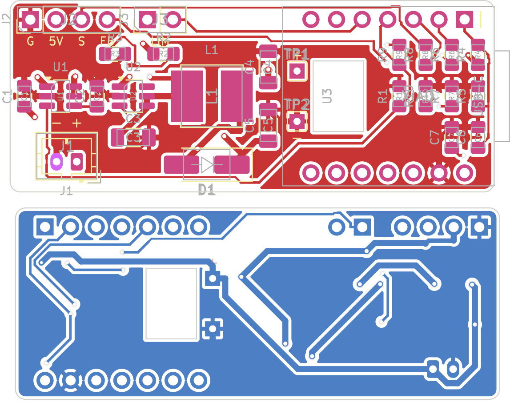

# Smart Vent XIAO backpack (KiCad)

A 48 × 19 mm two-layer board that holds all of the vent's auxiliary
circuitry. The XIAO ESP32-C6 plugs onto it with its two 1×7 headers.



**Status: routed, ready for a first prototype order.** It was autorouted with
Freerouting 2.5.0 from `fab/smart_vent_backpack.dsn`, and the result is in
`fab/smart_vent_backpack.ses`. After importing:
- every net is connected (0 unconnected pads)
- KiCad 7 DRC reports 0 violations, against fab rules of 0.3 mm to the edge,
  0.15 mm clearance and 0.12 mm minimum track
- the PCB's netlist matches the schematic's

Power nets (GND, VBAT, VSW, SW, V5) are 0.6 mm, narrowing to 0.36–0.45 mm
only at pads. Ground is poured on both layers. Order with
[`fab/gerbers.zip`](fab/gerbers.zip) (2 layers, 1.6 mm, 1 oz, any colour).
This is an untested first revision, so order a small batch.

## Circuit

| Block | Parts | Notes |
|---|---|---|
| Battery in | J1 (JST-PH 2 mm), TP1/TP2 | TP1/TP2 are wire pads. Run short wires through the window to the XIAO's BAT+/BAT− pads, which charge the cell over USB-C |
| Servo power switch | U1 TPS22917 load switch, C1, R1 (keeps it off); **C2 not fitted** | Cuts the cell off completely between moves (nanoamp leakage). Its ON pin is XIAO **D3** |
| 5 V boost | U2 MT3608, L1 10 µH, D1 SS34, C3–C5 22 µF, R2/R3 | Vout = 0.6 V × (1 + 51k/6.8k) = 5.1 V (both JLCPCB basic parts). Only powered while U1 is on |
| Servo | J2: GND, +5V, SIG, FB | SIG from **D2** through R8 (330 Ω). FB (0–3.3 V on the SER0046) through R6 1 kΩ to **D1**, with R7 100 kΩ pull-down and C7 filter |
| Battery sense | R4/R5 1M/1M, C6 | To **D0**. Draws about 2 µA |
| Limit switch | J3 | Fed from **D3** through R9 (1 kΩ), returns to **D4** with R10 (100 kΩ) pull-down. Only live while the servo is powered |

These pins match `common/smart-vent-thread-battery-base.yaml`, so the
firmware needs no changes.

## Building it

- All passives are 0805 (1206 for the 22 µF capacitors) with hand-solder
  pads. Both ICs are SOT-23-6. Parts list: [`fab/bom.csv`](fab/bom.csv).
- **Inductor:** any shielded 10 µH in 6 × 6 mm with a saturation current of
  2.5 A or more. A stalled servo pulls about 1.3 A from the cell through the
  boost converter.
- **Battery connector polarity:** JST-PH leads aren't standardized. Pin 1
  (square pad) is **+**. Check your cell's leads before plugging in.
- Mount the XIAO on the **top** with standard headers. Only the 0805 parts
  sit underneath it. Solder the battery wires to the XIAO's BAT pads before
  stacking the boards.

## JLCPCB assembly (PCBA)

Upload these three to JLCPCB with **PCB Assembly** turned on (top side, Economic):

| File | What |
|---|---|
| [`fab/gerbers.zip`](fab/gerbers.zip) | Board |
| [`fab/jlcpcb/bom_jlcpcb.csv`](fab/jlcpcb/bom_jlcpcb.csv) | Comment, Designator, Footprint, LCSC Part # |
| [`fab/jlcpcb/cpl_jlcpcb.csv`](fab/jlcpcb/cpl_jlcpcb.csv) | Designator, Mid X, Mid Y, Layer, Rotation |

- **What JLCPCB places:** all 21 SMD parts. 11 BOM lines are JLCPCB
  **Basic** parts. 3 are **Extended**, which carries a feeder fee per order:
  TPS22917DBVR (C2681320), MT3608 (C84817) and SRN6045TA-100M (C2046332).
  Part numbers and stock were checked against JLCPCB's parts library on
  2026-11-01.
- **Left for you:** the through-hole parts (J1 JST-PH C131337, J2, J3, the
  XIAO socket headers and the TP1/TP2 wire pads) aren't in the files. Solder
  them yourself, or add them to the order if you want JLCPCB's through-hole
  service.
- **Rotations:** the CPL applies JLCPCB's usual +180° for SOT-23 parts. In
  JLCPCB's placement preview, **check that pin 1 of U1 and U2 and the
  cathode band of D1 sit on the marked pads** before confirming. Rotate any
  part that's off there; the files don't need regenerating.

## Design review notes (v0.1)

- **C2 is DNP (not fitted).** TI's datasheet (SLVSDW8B, Table 6-1 and §9)
  says the CT slew capacitor goes from **CT to VIN**, but this board wires it
  to GND. CT may float ("fastest timing"). That gives about a 120 µs turn-on
  and a brief ~0.7 A inrush into C3, which is fine for the 2 A switch and the
  10 A cell. Fix it properly in the next revision if a slower start is wanted.
- **Checked against datasheets:** the TPS22917 and MT3608 pinouts, the
  MT3608 FB voltage (0.6 V), EN tied to the input (allowed), and the input
  range (2–24 V). GPIO0/1 are ADC1 channels 0/1. None of the pins used
  (GPIO0, 1, 2, 21, 22) is a strapping pin; those are GPIO4, 5, 8, 9 and 15.
- **Fit in the vent tower:** solder the XIAO **directly** onto its male
  headers (no female sockets), and use **right-angle** headers for J2/J3.
  The pads are the same, and this keeps the stack inside the 17 mm between
  the cell holder and the partition (1 mm and 0.9 mm clearance). Trim the
  through-hole leads on the back to about 2 mm.
- **Battery wire window:** its position comes from Seeed's description
  ("near D5 / D8"). If the BAT pads end up off the window, route the two
  wires around the board edge to TP1/TP2.

## Hand soldering

Everything is hand-solderable with a fine-tip iron, flux and tweezers:
- 0805 and 1206 parts on KiCad's hand-solder pads.
- Both ICs are SOT-23-6 (0.95 mm pitch) on the hand-solder variant.
- The inductor's terminals are mostly under its body, so its pads extend
  0.8 mm past the Bourns land pattern for the iron. Tin one pad, place the
  part, then heat the extended pad until solder wicks under.
- No vias sit in pads, and ground pads use thermal spokes, so they heat up
  normally.

Suggested order:
1. The low parts under the XIAO (R1, R4–R10, C6, C7). They're unreachable
   once the XIAO is fitted.
2. U1, U2, C1–C5, R2, R3, D1, then L1.
3. Before fitting the XIAO, check that 5 V comes up: connect the cell and
   pull D3 (SRV_EN) high through about 1 kΩ. J2 pin 2 should read about
   5.1 V, and about 0 V again once D3 is released.
4. J1, J2 and J3 (right-angle), then the XIAO, soldered directly on its
   male headers. Solder the battery wires to
   the XIAO's BAT pads, pass them through the window, and solder them to
   TP1 (+) and TP2 (−).

## Routing

`generate.py` builds everything from one parts table: the schematic (net
labels on every pin), the placed PCB, net classes (0.6 mm for power nets),
ground pours, Gerbers, the parts list, and the checks (schematic vs PCB
nets, DRC).

```bash
/usr/bin/python3 generate.py                              # place, write fab/smart_vent_backpack.dsn
# route fab/smart_vent_backpack.dsn with Freerouting (or similar) -> .ses
/usr/bin/python3 generate.py --ses fab/smart_vent_backpack.ses   # import routes, pour, DRC, Gerbers
# GND tracks that hug the battery window are dropped on import (the pours carry GND)
```

The router's output can also be imported straight into KiCad (**File →
Import → Specctra Session**) on the generated `.kicad_pcb`.

Requires KiCad 7 or later. Set `KICAD7_FOOTPRINT_DIR` if KiCad's global
libraries aren't configured.
